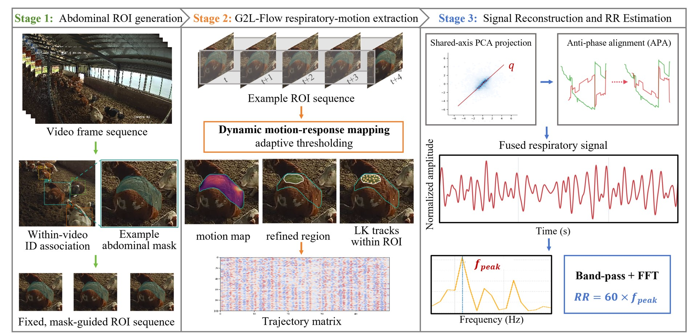

# Multi-view-Cattle-RR-Estimation

A multi-view cattle respiratory-rate estimation project based on abdominal-region observations under practical farm conditions.

## Overview

## 1️⃣ Data

The dataset contains RGB abdominal-region images and their corresponding annotations. The images are organized into training, validation, and test splits. Source videos are not included in the release. The release also includes video clips for respiratory rate (RR) estimation.

The datasets are available in the Baidu Netdisk repository, [https://pan.baidu.com/s/1hLCwoc6B8VnK4tdvi-YTrQ] (Access code: 1225).

## 2️⃣ Results

### Abdominal ROI Segmentation Model Comparison

| Model | Params (M) | GFLOPs | Mask mAP50 (%) | Mask mAP50:95 (%) | Processing time (ms/image, mean ± SD) |
| --- | ---: | ---: | ---: | ---: | ---: |
| Mask R-CNN | 43.97 | 190.98 | 54.21 | 18.84 | 92.66 ± 9.90 |
| YOLACT | 34.73 | 148.36 | 13.58 | 3.27 | 194.45 ± 95.69 |
| SOLOv2 | 46.23 | 284.24 | 13.95 | 3.30 | 179.42 ± 35.78 |
| YOLOv8n-seg | 3.26 | 11.15 | 80.69 | 32.67 | 225.65 ± 97.81 |
| YOLO11n-seg | 2.83 | 9.44 | 80.85 | 32.34 | 293.96 ± 116.41 |
| YOLO26n-seg | 2.69 | 8.89 | 78.64 | 30.23 | 247.91 ± 108.27 |

### Respiratory Rate Estimation Results of the Full Method

| Method | MAE (95% CI) | RMSE (95% CI) | MAPE (95% CI) | Bias (95% CI) | Pearson r (95% CI) |
| --- | --- | --- | --- | --- | --- |
| Full | 2.67 [2.36, 3.05] | 3.39 [2.97, 3.86] | 7.19 [6.37, 8.26] | 0.63 [0.05, 1.28] | 0.86 [0.80, 0.90] |
